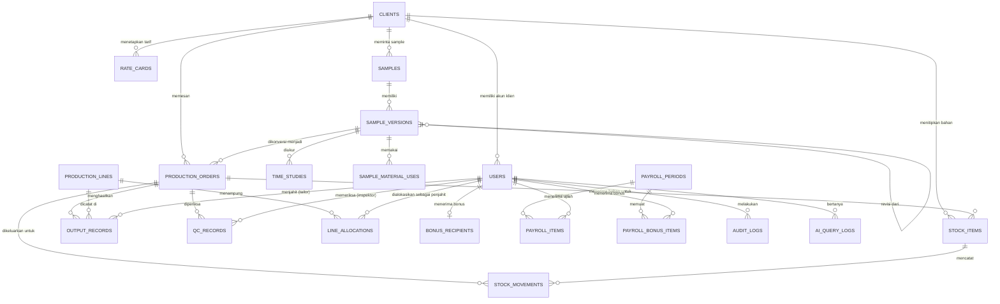

# Desain Database project-loe5

Dokumen ini mendefinisikan seluruh skema database PostgreSQL 16 untuk platform operasional pabrik garmen Ciwidey. Cakupannya meliputi modul Sample, Gudang Multi-Klien, Produksi, QC, Payroll, Portal Klien, dan dua asisten AI.

Dokumen ini berstatus **draft untuk disepakati tim**. Bagian 9 mencantumkan perubahan terhadap skema Prisma yang sudah ada dan perlu dimigrasikan setelah desain disetujui.

---

## 1. Prinsip desain

1. **Integritas dijaga di database, bukan hanya di aplikasi.** Aturan kritis seperti anti-kontaminasi silang, kunci verifikasi, dan append-only dipasang sebagai constraint dan trigger. Dengan begitu, bug di layer aplikasi tidak bisa merusak data.
2. **Uang memakai tipe exact.** Semua nilai rupiah memakai `NUMERIC(14,2)`, bukan `FLOAT`, agar pembulatan payroll tidak meleset.
3. **Waktu memakai `TIMESTAMPTZ`.** Penyimpanan dalam UTC, tampilan dan perhitungan harian dalam zona `Asia/Jakarta`.
4. **Histori tidak dihapus.** Catatan output, QC, pergerakan stok, dan hasil payroll bersifat append-only atau terkunci setelah diverifikasi.
5. **Isolasi data klien.** Setiap data operasional terhubung ke `client_id`, dan akun klien hanya bisa membaca baris miliknya.
6. **Nama tabel dan kolom memakai `snake_case` bahasa Inggris**, sesuai konvensi Prisma `@@map` dan `@map` yang sudah dipakai.

---

## 2. Daftar entitas per modul

| Modul | Tabel |
|---|---|
| Core | `clients`, `users`, `production_orders`, `audit_logs` |
| Sample (FR-1 s.d. FR-4) | `samples`, `sample_versions`, `time_studies`, `sample_material_uses` |
| Gudang (FR-5, FR-6) | `stock_items`, `stock_movements` |
| Produksi (FR-7) | `production_lines`, `line_allocations`, `rate_cards`, `output_records` |
| QC (FR-8, FR-9) | `qc_records` |
| Payroll (FR-10) | `payroll_settings`, `bonus_recipients`, `payroll_periods`, `payroll_items`, `payroll_bonus_items` |
| AI (P1) | `ai_query_logs` |

Total 19 tabel dan 9 enum.

---

## 3. Diagram relasi (ERD)

---

## 4. Enum

| Enum | Nilai | Dipakai oleh |
|---|---|---|
| `role` | OWNER, TIM_SAMPLE, GUDANG, KEPALA_PRODUKSI, PENJAHIT, QC_INSPECTOR, FINANCE_PAYROLL, KLIEN_MAKLON | `users.role` |
| `scheme` | CMT, SEMI_CMT, FULL_PACKAGE | `production_orders.scheme` |
| `order_status` | OPEN, IN_PRODUCTION, QC, DONE, CANCELLED | `production_orders.status` |
| `sample_version_status` | DRAFT, APPROVED, CONVERTED | `sample_versions.status` |
| `stock_type` | RAW, WIP, FINISHED | `stock_items.type` |
| `movement_direction` | IN, OUT | `stock_movements.direction` |
| `qc_status` | LOLOS, REPAIR, DEFECT | `qc_records.status` |
| `defect_category` | JAHITAN, NODA, UKURAN, BAHAN, LAINNYA | `qc_records.defect_category` |
| `ai_channel` | OWNER_TRACKER, PROSPECT | `ai_query_logs.channel` |

Pada skema Prisma saat ini, `order_status`, `sample_version_status`, `movement_direction`, dan `defect_category` masih berupa `String`. Perubahannya dijelaskan di bagian 9.

---

## 5. Detail tabel

Keterangan kolom: **PK** primary key, **FK** foreign key, **UQ** unique, **NN** NOT NULL.

### 5.1 Core

**`clients`**: daftar klien (brand internal dan maklon B2B).

| Kolom | Tipe | Constraint | Keterangan |
|---|---|---|---|
| id | TEXT | PK | cuid |
| code | VARCHAR(20) | UQ, NN | kode singkat, misal `SNH`, `KLA` |
| name | VARCHAR(150) | NN | nama klien |
| is_internal | BOOLEAN | NN, default false | true untuk brand Snøhund |
| is_active | BOOLEAN | NN, default true | |
| created_at | TIMESTAMPTZ | NN, default now() | |

**`users`**: seluruh akun pengguna sistem.

| Kolom | Tipe | Constraint | Keterangan |
|---|---|---|---|
| id | TEXT | PK | |
| name | VARCHAR(120) | NN | |
| email | VARCHAR(255) | UQ, NN | disimpan lowercase |
| password_hash | VARCHAR(100) | NN | bcrypt |
| role | role | NN | |
| client_id | TEXT | FK clients, NULL | wajib terisi jika role `KLIEN_MAKLON` |
| is_active | BOOLEAN | NN, default true | nonaktifkan, jangan dihapus |
| created_at | TIMESTAMPTZ | NN | |
| updated_at | TIMESTAMPTZ | NN | |

Constraint: `CHECK ((role = 'KLIEN_MAKLON') = (client_id IS NOT NULL))`. Peran klien wajib punya klien, dan peran lain tidak boleh punya klien.

**`production_orders`**: pesanan produksi massal hasil konversi sample.

| Kolom | Tipe | Constraint | Keterangan |
|---|---|---|---|
| id | TEXT | PK | |
| code | VARCHAR(30) | UQ, NN | misal `ORD-2026-001` |
| client_id | TEXT | FK clients, NN | |
| sample_version_id | TEXT | FK sample_versions, NULL | versi sample asal |
| scheme | scheme | NN | |
| target_qty | INTEGER | NN, CHECK > 0 | |
| spec_json | JSONB | NN | snapshot spesifikasi dan riwayat versi |
| status | order_status | NN, default OPEN | |
| created_by | TEXT | FK users, NN | |
| created_at | TIMESTAMPTZ | NN | |
| updated_at | TIMESTAMPTZ | NN | |

**`audit_logs`**: jejak aktivitas penting, termasuk percobaan yang diblokir.

| Kolom | Tipe | Constraint | Keterangan |
|---|---|---|---|
| id | BIGSERIAL | PK | |
| user_id | TEXT | FK users, NULL | NULL jika aksi publik |
| action | VARCHAR(60) | NN | misal `BLOCKED_ISSUE`, `VERIFY_OUTPUT`, `FINALIZE_PAYROLL` |
| entity_type | VARCHAR(40) | NN | nama tabel tujuan |
| entity_id | TEXT | NULL | |
| detail | JSONB | NN | |
| created_at | TIMESTAMPTZ | NN | |

Tabel ini append-only (lihat bagian 7).

### 5.2 Sample

**`samples`**: master sample.

| Kolom | Tipe | Constraint | Keterangan |
|---|---|---|---|
| id | TEXT | PK | |
| code | VARCHAR(20) | UQ, NN | misal `SMP-001` |
| name | VARCHAR(150) | NN | |
| client_id | TEXT | FK clients, NULL | NULL jika sample untuk calon klien yang belum terdaftar |
| created_by | TEXT | FK users, NN | |
| created_at | TIMESTAMPTZ | NN | |

**`sample_versions`**: setiap revisi membentuk versi baru yang terhubung ke versi sebelumnya.

| Kolom | Tipe | Constraint | Keterangan |
|---|---|---|---|
| id | TEXT | PK | |
| sample_id | TEXT | FK samples, NN | |
| version_number | INTEGER | NN, CHECK >= 1 | |
| parent_id | TEXT | FK sample_versions, NULL | versi sebelumnya |
| spec_json | JSONB | NN | spesifikasi bahan, warna, ukuran |
| status | sample_version_status | NN, default DRAFT | |
| approved_by | TEXT | FK users, NULL | |
| approved_at | TIMESTAMPTZ | NULL | |
| created_by | TEXT | FK users, NN | |
| created_at | TIMESTAMPTZ | NN | |

Constraint:
- `UNIQUE (sample_id, version_number)`
- `CHECK ((status = 'DRAFT') OR (approved_at IS NOT NULL))`. Versi yang tidak berstatus DRAFT wajib sudah disetujui.
- Trigger: spec_json tidak boleh diubah setelah status APPROVED atau CONVERTED.

**`time_studies`**: waktu pengerjaan per komponen, terikat ke versi sample (bukan ke sample induk), karena waktu bisa berbeda antarversi.

| Kolom | Tipe | Constraint | Keterangan |
|---|---|---|---|
| id | TEXT | PK | |
| sample_version_id | TEXT | FK sample_versions, NN | |
| component_name | VARCHAR(120) | NN | |
| seconds | NUMERIC(10,2) | NN, CHECK > 0 | |
| recorded_by | TEXT | FK users, NN | |
| recorded_at | TIMESTAMPTZ | NN | |

**`sample_material_uses`**: pemakaian bahan saat membuat sample.

| Kolom | Tipe | Constraint | Keterangan |
|---|---|---|---|
| id | TEXT | PK | |
| sample_version_id | TEXT | FK sample_versions, NN | |
| material_name | VARCHAR(150) | NN | |
| quantity | NUMERIC(12,3) | NN, CHECK > 0 | |
| unit | VARCHAR(20) | NN | |
| recorded_by | TEXT | FK users, NN | |
| recorded_at | TIMESTAMPTZ | NN | |

### 5.3 Gudang Multi-Klien

**`stock_items`**: satu baris = satu lot bahan milik klien untuk satu pesanan.

| Kolom | Tipe | Constraint | Keterangan |
|---|---|---|---|
| id | TEXT | PK | |
| code | VARCHAR(30) | UQ, NN | misal `LOT-...` |
| name | VARCHAR(150) | NN | |
| type | stock_type | NN | |
| client_id | TEXT | FK clients, NN | **Tag klien wajib (FR-6.1)** |
| order_id | TEXT | FK production_orders, NN | **Tag pesanan wajib (FR-6.1)** |
| quantity | NUMERIC(12,3) | NN, CHECK >= 0 | sisa stok, di-cache dari movements |
| unit | VARCHAR(20) | NN | |
| received_at | TIMESTAMPTZ | NN | |
| created_by | TEXT | FK users, NN | |

**`stock_movements`**: pergerakan stok, append-only.

| Kolom | Tipe | Constraint | Keterangan |
|---|---|---|---|
| id | BIGSERIAL | PK | |
| item_id | TEXT | FK stock_items, NN | |
| direction | movement_direction | NN | |
| quantity | NUMERIC(12,3) | NN, CHECK > 0 | |
| order_id | TEXT | FK production_orders, NN | pesanan tujuan (IN: pesanan pemilik) |
| note | VARCHAR(255) | NULL | |
| created_by | TEXT | FK users, NN | |
| created_at | TIMESTAMPTZ | NN | |

Trigger anti-kontaminasi (lihat bagian 6.1) dan trigger pemeliharaan saldo ada di sini.

### 5.4 Produksi

**`production_lines`**: line produksi paralel.

| Kolom | Tipe | Constraint | Keterangan |
|---|---|---|---|
| id | TEXT | PK | |
| name | VARCHAR(50) | UQ, NN | misal `Line A` |
| capacity | INTEGER | NULL, CHECK > 0 | jumlah mesin, opsional |
| is_active | BOOLEAN | NN, default true | |

Kapasitas dinamis sampai ±70 mesin dicapai dengan menambah baris line, bukan dengan mengubah skema.

**`line_allocations`**: riwayat penempatan penjahit ke line.

| Kolom | Tipe | Constraint | Keterangan |
|---|---|---|---|
| id | TEXT | PK | |
| line_id | TEXT | FK production_lines, NN | |
| tailor_id | TEXT | FK users, NN | |
| allocated_at | TIMESTAMPTZ | NN | |
| ended_at | TIMESTAMPTZ | NULL | NULL berarti masih aktif |
| allocated_by | TEXT | FK users, NN | mandor |

Index unik parsial: `UNIQUE (tailor_id) WHERE ended_at IS NULL`. Satu penjahit hanya boleh punya satu alokasi aktif. Ini menggantikan kolom `active` boolean di skema sekarang.

**`rate_cards`**: tarif per klien dan komponen, dengan tanggal berlaku. Tarif bisa berubah tanpa mengubah hasil payroll periode sebelumnya.

| Kolom | Tipe | Constraint | Keterangan |
|---|---|---|---|
| id | TEXT | PK | |
| client_id | TEXT | FK clients, NN | |
| component | VARCHAR(120) | NN | |
| cutting_rate | NUMERIC(14,2) | NN, CHECK >= 0 | ongkos potong |
| sewing_rate | NUMERIC(14,2) | NN, CHECK >= 0 | ongkos jahit per pcs |
| effective_from | DATE | NN | |
| created_by | TEXT | FK users, NN | |

`UNIQUE (client_id, component, effective_from)`. Tarif yang berlaku untuk suatu output dipilih berdasarkan tanggal output dan `effective_from` terbaru.

**`output_records`**: catatan output mandor per interval 30 menit.

| Kolom | Tipe | Constraint | Keterangan |
|---|---|---|---|
| id | TEXT | PK | |
| order_id | TEXT | FK production_orders, NN | |
| line_id | TEXT | FK production_lines, NN | |
| tailor_id | TEXT | FK users, NN | |
| component | VARCHAR(120) | NN | |
| interval_start | TIMESTAMPTZ | NN | awal interval 30 menit (dibulatkan ke :00 atau :30 WIB) |
| pcs | INTEGER | NN, CHECK > 0 | |
| recorded_by | TEXT | FK users, NN | mandor yang menginput |
| verified_by | TEXT | FK users, NULL | |
| verified_at | TIMESTAMPTZ | NULL | terisi = catatan terkunci |
| rate_applied | NUMERIC(14,2) | NULL | tarif jahit saat verifikasi (snapshot) |
| wage_amount | NUMERIC(14,2) | NULL | pcs x rate_applied, diisi saat verifikasi |
| created_at | TIMESTAMPTZ | NN | |
| updated_at | TIMESTAMPTZ | NN | |

Constraint:
- `CHECK ((verified_at IS NULL) = (verified_by IS NULL))`
- `CHECK ((verified_at IS NULL) = (wage_amount IS NULL))`
- `CHECK (EXTRACT(MINUTE FROM interval_start AT TIME ZONE 'Asia/Jakarta') IN (0, 30))`. Interval harus rapi di batas 30 menit.

Trigger: setelah `verified_at` terisi, semua kolom tidak boleh diubah, dan baris tidak boleh dihapus.

Snapshot `rate_applied` dan `wage_amount` dibuat saat verifikasi supaya payroll tidak berubah walaupun tarif diedit kemudian.

### 5.5 QC

**`qc_records`**: hasil pemeriksaan QC, append-only.

| Kolom | Tipe | Constraint | Keterangan |
|---|---|---|---|
| id | TEXT | PK | |
| order_id | TEXT | FK production_orders, NN | |
| component | VARCHAR(120) | NN | |
| qty | INTEGER | NN, CHECK > 0 | |
| status | qc_status | NN | |
| defect_category | defect_category | NULL | |
| note | VARCHAR(500) | NULL | |
| inspector_id | TEXT | FK users, NN | |
| checked_at | TIMESTAMPTZ | NN | |

Constraint: `CHECK ((status = 'LOLOS') = (defect_category IS NULL))`. Status REPAIR atau DEFECT wajib punya kategori cacat, dan LOLOS tidak boleh punya kategori (FR-9).

### 5.6 Payroll

**`payroll_settings`**: pengaturan tunggal.

| Kolom | Tipe | Constraint | Keterangan |
|---|---|---|---|
| id | SMALLINT | PK, CHECK (id = 1) | singleton |
| meal_percent | NUMERIC(5,2) | NN, CHECK BETWEEN 0 AND 100 | |
| bonus_per_pcs | NUMERIC(14,2) | NN, CHECK >= 0 | |
| updated_by | TEXT | FK users, NN | |
| updated_at | TIMESTAMPTZ | NN | |

Setiap perubahan juga dicatat di `audit_logs` dengan nilai lama dan baru.

**`bonus_recipients`**: penerima pool bonus QC.

| Kolom | Tipe | Constraint | Keterangan |
|---|---|---|---|
| id | TEXT | PK | |
| user_id | TEXT | FK users, UQ, NN | |
| is_active | BOOLEAN | NN, default true | |

Catatan: BRD menetapkan tiga penerima (2 mandor, 1 kepala operasional). Jumlah ini dijaga di layer aplikasi, bukan dengan constraint, supaya fleksibel jika aturan berubah.

**`payroll_periods`**: header periode payroll yang sudah difinalisasi.

| Kolom | Tipe | Constraint | Keterangan |
|---|---|---|---|
| id | TEXT | PK | |
| start_date | DATE | NN | inklusif, WIB |
| end_date | DATE | NN | eksklusif, WIB |
| total_wage | NUMERIC(14,2) | NN | total ongkos jahit |
| total_meal | NUMERIC(14,2) | NN | pool uang makan |
| total_bonus | NUMERIC(14,2) | NN | pool bonus QC |
| meal_percent_applied | NUMERIC(5,2) | NN | snapshot persentase |
| bonus_per_pcs_applied | NUMERIC(14,2) | NN | snapshot nilai bonus |
| finalized_by | TEXT | FK users, NN | |
| finalized_at | TIMESTAMPTZ | NN | |

Constraint:
- `CHECK (end_date > start_date)`
- `EXCLUDE USING gist (daterange(start_date, end_date) WITH &&)`. Dua periode tidak boleh tumpang tindih. Ini memerlukan ekstensi `btree_gist`.

**`payroll_items`**: upah dan uang makan per penjahit per periode.

| Kolom | Tipe | Constraint | Keterangan |
|---|---|---|---|
| id | TEXT | PK | |
| period_id | TEXT | FK payroll_periods, NN | |
| tailor_id | TEXT | FK users, NN | |
| total_pcs | INTEGER | NN, CHECK >= 0 | |
| wage_amount | NUMERIC(14,2) | NN | |
| meal_amount | NUMERIC(14,2) | NN | |

`UNIQUE (period_id, tailor_id)`.

**`payroll_bonus_items`**: pembagian bonus QC per penerima per periode.

| Kolom | Tipe | Constraint | Keterangan |
|---|---|---|---|
| id | TEXT | PK | |
| period_id | TEXT | FK payroll_periods, NN | |
| user_id | TEXT | FK users, NN | |
| amount | NUMERIC(14,2) | NN | |

`UNIQUE (period_id, user_id)`.

Tabel `payroll_items` dan `payroll_bonus_items` bersifat append-only setelah periode difinalisasi.

### 5.7 AI

**`ai_query_logs`**: catatan pertanyaan dan jawaban asisten. Dipakai untuk audit, evaluasi kualitas, dan pemantauan biaya.

| Kolom | Tipe | Constraint | Keterangan |
|---|---|---|---|
| id | BIGSERIAL | PK | |
| channel | ai_channel | NN | |
| user_id | TEXT | FK users, NULL | NULL untuk calon klien |
| question | TEXT | NN | dipotong maksimal 1.000 karakter |
| answer | TEXT | NN | |
| input_tokens | INTEGER | NULL | |
| output_tokens | INTEGER | NULL | |
| created_at | TIMESTAMPTZ | NN | |

Kebijakan retensi: pertanyaan calon klien dihapus setelah 90 hari. Tidak ada alamat IP yang disimpan.

---

## 6. Aturan integritas di database

### 6.1 Anti-kontaminasi silang (FR-6.2)

Trigger `BEFORE INSERT ON stock_movements` untuk `direction = 'OUT'`:

1. Ambil `client_id` dan `order_id` dari `stock_items` (item yang dikeluarkan).
2. Pastikan `NEW.order_id = stock_items.order_id`, dan klien pesanan tujuan sama dengan `stock_items.client_id`.
3. Jika tidak cocok, `RAISE EXCEPTION` dengan pesan `BLOCKED_ISSUE`, lalu insert baris `audit_logs` di transaksi yang sama. Catatan: `RAISE` akan membatalkan transaksi, jadi audit ditulis lewat fungsi terpisah dengan `dblink` atau dicatat di aplikasi sebelum melempar error. Pilihan ini ditandai di bagian 10.

Trigger `BEFORE INSERT ON stock_movements` untuk `direction = 'OUT'` juga memeriksa `quantity <= stock_items.quantity` dengan lock baris (`SELECT ... FOR UPDATE`) untuk mencegah race condition.

Trigger `AFTER INSERT ON stock_movements` memperbarui `stock_items.quantity` (IN menambah, OUT mengurangi). Constraint `CHECK (quantity >= 0)` menjadi pengaman terakhir.

### 6.2 Kunci verifikasi output (Story 1.2)

- Trigger `BEFORE UPDATE ON output_records`: jika `OLD.verified_at IS NOT NULL`, lempar error. Perubahan apa pun ditolak.
- Trigger `BEFORE DELETE ON output_records`: jika `OLD.verified_at IS NOT NULL`, lempar error.
- Trigger `BEFORE UPDATE` saat verifikasi: saat `verified_at` berubah dari NULL ke nilai, isi `rate_applied` dari `rate_cards` yang berlaku pada `interval_start`, lalu hitung `wage_amount = pcs * rate_applied`.

### 6.3 Append-only

Trigger `BEFORE UPDATE OR DELETE` yang melempar error dipasang pada:
- `audit_logs`
- `stock_movements`
- `qc_records`
- `payroll_periods`, `payroll_items`, `payroll_bonus_items`
- `ai_query_logs` (kecuali penghapusan oleh job retensi, yang memakai role khusus)

### 6.4 Penjahit hanya pada line yang dialokasikan

Pengecekan ini sulit dibuat sebagai constraint sederhana karena melibatkan tanggal. Usulan: trigger `BEFORE INSERT ON output_records` memastikan ada `line_allocations` aktif (`ended_at IS NULL`) untuk `tailor_id` dan `line_id` tersebut. Ini juga bisa dibiarkan di layer aplikasi dengan catatan bahwa pengecekan di DB adalah pilihan yang lebih aman.

### 6.5 Sample yang sudah disetujui

Trigger `BEFORE UPDATE ON sample_versions`: jika `OLD.status IN ('APPROVED', 'CONVERTED')`, izinkan hanya perubahan `status` dari APPROVED ke CONVERTED. Kolom lain tidak boleh berubah.

### 6.6 Batas peran klien

Peran `KLIEN_MAKLON` hanya bisa membaca data dengan `client_id` miliknya. Aturan ini dijalankan di aplikasi lewat `clientScope()`. Sebagai lapisan tambahan, Postgres Row-Level Security bisa dipasang pada `production_orders`, `stock_items`, dan `payroll_items` (bagian 10).

---

## 7. Indeks

| Tabel | Indeks | Tujuan |
|---|---|---|
| users | UQ (email) | login |
| production_orders | (client_id, status) | portal klien dan dashboard |
| stock_items | (client_id), (order_id) | inventaris per klien dan per pesanan |
| stock_movements | (item_id, created_at) | riwayat per item |
| line_allocations | UQ parsial (tailor_id) WHERE ended_at IS NULL | satu alokasi aktif per penjahit |
| line_allocations | (line_id) WHERE ended_at IS NULL | daftar penjahit aktif per line |
| output_records | (interval_start) | rekap per interval |
| output_records | (tailor_id, interval_start) | payroll per penjahit |
| output_records | (order_id, interval_start) | dashboard per pesanan |
| output_records | (verified_at) WHERE verified_at IS NULL | antrean verifikasi mandor |
| qc_records | (order_id, checked_at) | riwayat QC per pesanan |
| qc_records | (checked_at) WHERE status = 'LOLOS' | pool bonus per periode |
| rate_cards | (client_id, component, effective_from DESC) | pencarian tarif berlaku |
| audit_logs | (action, created_at) | pencarian blokir dan aktivitas |
| ai_query_logs | (channel, created_at) | retensi dan pemantauan |

---

## 8. Keamanan dan privasi

- **Password** disimpan sebagai hash bcrypt, tidak pernah plaintext.
- **Secret** (`AUTH_SECRET`, API key Bedrock) hanya ada di environment, tidak di database.
- **Data pribadi calon klien** di `ai_query_logs` dibatasi: tanpa IP, tanpa nama, dan dihapus setelah 90 hari.
- **Role database terpisah**: aplikasi memakai role `loe_app` dengan hak `SELECT, INSERT, UPDATE` pada tabel operasional dan `INSERT` saja pada tabel append-only. Migrasi memakai role `loe_migrator`. Penghapusan pada tabel append-only hanya dilakukan oleh role retensi.
- **Enkripsi**: koneksi ke PostgreSQL memakai SSL saat deploy.
- **Backup**: pg_dump harian dan WAL archiving untuk pemulihan titik waktu.

---

## 9. Perubahan dari skema Prisma saat ini

Ini daftar yang perlu dikerjakan sebelum migrasi pertama dijalankan, atau sebagai migrasi lanjutan jika migrasi awal sudah dibuat.

| No | Perubahan | Alasan |
|---|---|---|
| 1 | `Float` diganti `Decimal` (`@db.Decimal(14,2)`) untuk semua uang | Menghindari salah pembulatan rupiah |
| 2 | `ProductionOrder.status`, `SampleVersion.status`, `StockMovement.direction`, dan `QcRecord.defectCategory` diubah dari `String` menjadi enum | Integritas nilai |
| 3 | `LineAllocation.active` diganti `ended_at` dan dibuat index unik parsial | Satu alokasi aktif per penjahit |
| 4 | `TimeStudy` dan `SampleMaterialUse` terikat ke `sample_version_id` | Waktu dan bahan dicatat per revisi |
| 5 | `RateCard` ditambah `effective_from` dan diganti unique key | Tarif historis untuk payroll |
| 6 | `OutputRecord` ditambah `rate_applied`, `wage_amount`, `recorded_by`, dan `updated_at` | Snapshot upah saat verifikasi |
| 7 | `PayrollPeriod.result` (JSON) dipecah menjadi `payroll_periods`, `payroll_items`, dan `payroll_bonus_items` | Query dan laporan lebih mudah, serta ada constraint |
| 8 | Tambah `payroll_settings` dengan constraint singleton (`id = 1`) | Mencegah lebih dari satu baris pengaturan |
| 9 | `AuditLog` ditambah `entity_type` dan `entity_id` | Pelacakan aktivitas yang lebih jelas |
| 10 | Tambah tabel `ai_query_logs` | Audit dan pemantauan asisten AI |
| 11 | `User` ditambah `is_active` dan `updated_at`. `Client` ditambah `code` dan `is_internal` | Nonaktifkan akun tanpa menghapus histori |
| 12 | Tambah trigger dan constraint yang dijelaskan di bagian 6 dan 7 | Integritas di database |

Skema yang sudah ada juga belum punya `OutputRecord` dengan `recorded_by`, sehingga siapa yang menginput belum tercatat. Perubahan 6 menutup celah ini.

---

## 10. Keputusan terbuka untuk disepakati tim

1. **Pencatatan audit saat blokir anti-kontaminasi.** Jika trigger melempar `RAISE EXCEPTION`, transaksi ikut dibatalkan termasuk insert audit. Pilihan: (a) audit dicatat oleh aplikasi sebelum error dilempar, atau (b) memakai `dblink` untuk insert di luar transaksi. Usulan: pilihan (a), karena lebih sederhana dan cukup untuk MVP.
2. **Trigger 6.4 (penjahit hanya di line yang dialokasikan).** Dipasang di DB atau cukup di aplikasi? Usulan: di aplikasi untuk MVP, dan dipindah ke DB setelah demo.
3. **Row-Level Security untuk klien.** Dipasang sekarang atau setelah MVP? Usulan: setelah MVP, karena aplikasi sudah menerapkan `clientScope()`.
4. **Jumlah penerima bonus QC.** Dikunci 3 oleh aplikasi atau dibiarkan fleksibel? Usulan: dibiarkan fleksibel, tetapi dicatat sebagai aturan BRD.
5. **Kategori cacat sebagai enum atau tabel lookup.** Enum lebih sederhana. Tabel lookup memudahkan penambahan kategori tanpa migrasi. Usulan: enum untuk MVP.
6. **Status pesanan.** Nilai `IN_PRODUCTION` dan `QC` diisi otomatis dari aktivitas, atau diubah manual oleh Owner? Usulan: otomatis, dengan Owner bisa membatalkan.

---

## 11. Pemetaan ke BRD

| Kebutuhan | Tabel dan aturan utama |
|---|---|
| FR-1 s.d. FR-4 (sample, versi, time study, konversi) | `samples`, `sample_versions`, `time_studies`, `sample_material_uses`, `production_orders`, trigger 6.5 |
| FR-5, FR-6.1 (penerimaan dengan tag klien dan pesanan) | `stock_items` dengan `client_id` dan `order_id` NOT NULL |
| FR-6.2 (blokir anti-kontaminasi) | Trigger 6.1, `audit_logs` |
| FR-7.1 (alokasi dinamis) | `production_lines`, `line_allocations` |
| FR-7.2 (rate card per klien dan komponen) | `rate_cards` dengan `effective_from` |
| FR-7.3 (output 30 menit) | `output_records`, constraint interval |
| Story 1.2 (penjahit tidak bisa mengubah setelah verifikasi) | Trigger 6.2 |
| FR-8, FR-9 (QC dan kategori cacat) | `qc_records`, constraint 5.5, trigger 6.3 |
| FR-10.1 s.d. FR-10.3 (borongan, uang makan, bonus) | `payroll_items`, `payroll_bonus_items`, `payroll_settings`, `payroll_periods` |
| FR-10 (periode tidak tumpang tindih, hasil tidak berubah) | Exclude constraint pada `payroll_periods`, trigger append-only 6.3 |
| Isolasi data klien | `client_id` pada tabel operasional, `clientScope()`, opsional RLS |
| AI Business Tracker dan asisten calon klien (P1) | `ai_query_logs` |

---

## 12. Urutan migrasi yang disarankan

1. Aktifkan ekstensi `btree_gist` untuk exclude constraint payroll.
2. Buat enum, lalu tabel inti (`clients`, `users`, `production_orders`, `audit_logs`).
3. Buat tabel sample, gudang, produksi, QC, payroll, dan AI sesuai urutan dependensi.
4. Tambahkan seluruh trigger dan index.
5. Jalankan seed. Data uji harus lolos semua constraint dan trigger.
6. Jalankan skenario uji anti-kontaminasi, kunci verifikasi, dan append-only sebelum fitur UI dikerjakan.
